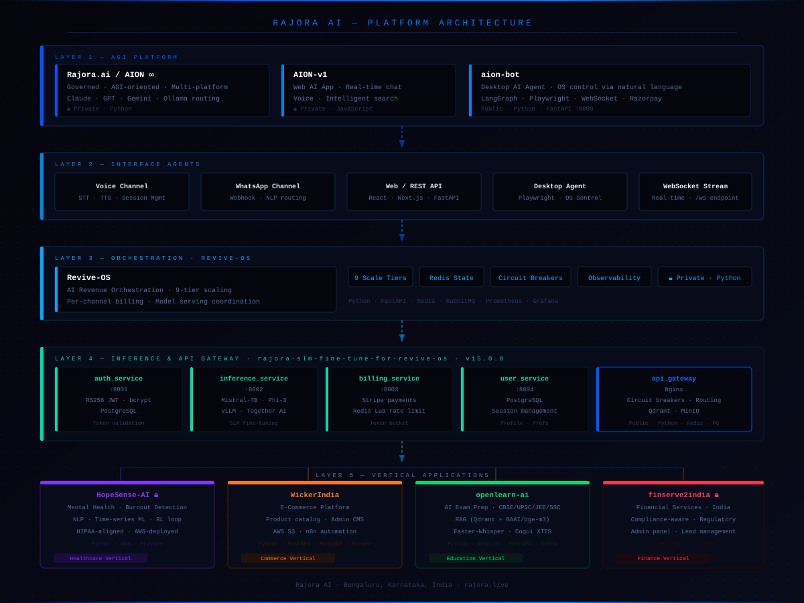

# Er. Rajeev Rajora
### Founder & AI Infrastructure Architect · Rajora AI

**One infrastructure. Multiple AI products. Engineered end to end.**

Building across **agentic AI · model orchestration · retrieval systems · automation · full-stack products · cloud infrastructure**

[🌐 Rajora AI](https://rajora.live) · [🧠 AION](https://rajora.co.in/) · [🛠️ Tool Guide](https://tools.guide.rajora.live/) · [📦 Repositories](https://github.com/rajeevrajora77-lab?tab=repositories) · [✉️ Contact](mailto:rajeev@rajora.live)

---

## Engineering thesis

Rajora AI is an AI-focused technology initiative building reusable foundations and domain-specific products. The central idea is simple: **solve recurring infrastructure problems once, then reuse the right components across products**—without pretending every application has identical requirements.

The engineering scope spans model integration and routing, agent workflows, retrieval and reranking, API and identity layers, data persistence, automation, user-facing applications, and deployment.

> **Design principle:** the model is one component of the system. Reliability, permissions, retrieval, observability, UX, and operating cost matter just as much.

## Live product ecosystem

| Product | Focus | Destination |
|---|---|---|
| **Rajora AI** | Company and AI product ecosystem | [rajora.live](https://rajora.live) |
| **AION** | AI workspace and assistant experience | [rajora.co.in](https://rajora.co.in/) |
| **Wicker India** | Digital commerce experience | [wicker.rajora.live](https://wicker.rajora.live/) |
| **FinServe2India** | Financial-services product discovery | [finserve2india.com](https://www.finserve2india.com/) |
| **Tool Guide** | AI tools directory | [tools.guide.rajora.live](https://tools.guide.rajora.live/) |
| **OpenLearn AI** | AI-assisted learning and exam preparation | [openlearn.rajora.live](https://openlearn.rajora.live/) |

*Links are provided as product entry points; current availability and individual features should be confirmed on the destination itself.*

## Flagship engineering

### 01 · AION — Agentic intelligence & automation

AION explores AI assistance that connects language-model capabilities to practical workflows, with web and desktop-agent work across the broader project family.

**Architecture areas**
- Model/provider integration and orchestration
- Tool execution and workflow automation
- Browser automation with Playwright
- Desktop interaction and screen capture in the desktop-agent project
- GitHub and file-system workflows
- Streaming interaction, application persistence, and safety controls

**Technology explored:** Python · LangGraph/LangChain · FastAPI · Playwright · PyAutoGUI · Tauri/Rust · SQLAlchemy · PostgreSQL · Redis

**Explore:** [AION web experience](https://rajora.co.in/) · [AION desktop agent — public repository](https://github.com/rajeevrajora77-lab/aion-bot)

### 02 · Rajora Search — Hybrid retrieval & reranking

A retrieval approach designed to combine exact lexical matches with semantic similarity and a reranking stage.

| Stage | Approach | Purpose |
|---|---|---|
| Lexical retrieval | BM25 | Preserve exact terms, identifiers, and keyword relevance |
| Dense retrieval | FAISS + sentence embeddings | Retrieve semantically related content |
| Reranking | Cross-encoder | Re-score candidates for query relevance |

The architecture can be extended with answer synthesis, streaming responses, evaluation datasets, and latency/quality measurements. Retrieval quality should be evaluated against representative queries rather than inferred from the component list alone.

**Explore:** [Rajora AI](https://rajora.live) · [Browse repositories](https://github.com/rajeevrajora77-lab?tab=repositories)

### 03 · Rajora SLM — Fine-tuning & inference infrastructure

An engineering track exploring domain-specific model adaptation and self-managed inference, including parameter-efficient fine-tuning approaches such as LoRA/QLoRA and serving components.

**Areas of interest:** model training/evaluation pipelines · inference serving · API gateway · authentication and usage controls · billing boundaries · shared SDKs

**Explore:** [SLM fine-tuning repository](https://github.com/rajeevrajora77-lab/rajora-slm-fine-tune-for-revive-os)

### 04 · Revive OS — Revenue workflow orchestration

A workflow-orchestration project focused on coordinating lead reactivation across messaging and voice channels. The engineering challenge is not simply sending messages; it is managing state, retries, channel-specific workflows, observability, and safe scale-up.

**Technology explored:** Python · FastAPI · Redis · RabbitMQ · Twilio · Prometheus/Grafana · Kubernetes/Helm

**Explore:** [Repository catalogue](https://github.com/rajeevrajora77-lab?tab=repositories)

### 05 · OpenLearn AI — AI-assisted learning

A learning product exploring exam preparation workflows, retrieval-augmented generation, question practice, and learning support.

**Architecture areas:** application UI · API services · retrieval pipeline · vector search · speech interfaces · learner workflows

**Explore:** [OpenLearn AI](https://openlearn.rajora.live/) · [Source repository](https://github.com/rajeevrajora77-lab/openlearn-ai)

### 06 · Wicker India — Commerce & automation

A commerce project bringing together a customer-facing storefront, backend services, and operational automation.

**Architecture areas:** product catalogue and ordering workflows · API/backend services · persistent storage · operational automation · deployment pipelines

**Explore:** [Live storefront](https://wicker.rajora.live/) · [Source repository](https://github.com/rajeevrajora77-lab/WickerIndia)

### 07 · HopeSense AI — Wellbeing analytics

A project exploring AI-assisted signals and analytics related to workplace wellbeing. Health-related predictions require careful validation, privacy safeguards, clear limitations, and human oversight; they should not be presented as clinical diagnoses.

**Explore:** [Public repository catalogue](https://github.com/rajeevrajora77-lab?tab=repositories)

---

## Platform architecture map

  
  Conceptual platform map. Individual products can use different components and deployment topologies.

### Core engineering layers

| Layer | Responsibilities | Example technologies |
|---|---|---|
| Experience | Web UI, desktop interaction, accessible workflows | React, Vite, Next.js, Tauri |
| API & identity | API boundaries, authentication, authorization, validation | FastAPI, Node.js, JWT |
| Agent orchestration | Tool routing, state transitions, model coordination | LangGraph, LangChain |
| Retrieval | Lexical search, embeddings, vector retrieval, reranking | BM25, FAISS, Qdrant |
| Models | Hosted model APIs and local/open model experiments | Provider APIs, Hugging Face, Ollama, vLLM |
| Persistence & cache | Durable data, sessions, task state, caching | PostgreSQL, MongoDB, Redis |
| Delivery & operations | Containers, deployment, CI/CD, monitoring | Docker, GitHub Actions, cloud platforms |

*These are technologies used or explored across different projects—not a claim that every product runs every component.*

## Security & reliability principles

AI-enabled systems need stronger boundaries than a prompt and an API call. My engineering checklist prioritizes:

- **Least privilege:** scope credentials and tool permissions to the task.
- **Input and action validation:** validate tool arguments and constrain high-impact actions.
- **Execution isolation:** sandbox untrusted code and avoid unrestricted shell execution.
- **Secrets management:** keep credentials out of source control and rotate exposed keys.
- **Data protection:** minimize sensitive data, enforce access control, and use appropriate encryption.
- **Observability:** capture actionable logs, errors, latency, and usage without leaking secrets.
- **Testing:** combine unit/integration tests, dependency scanning, and deployment checks.
- **Human oversight:** require confirmation for consequential or irreversible operations.

Security features and compliance requirements must be verified per deployment; a checklist is not itself a security audit or certification.

## Technology landscape

<strong>AI, agents & retrieval</strong>

Python · LangGraph · LangChain · RAG · Embeddings · Hugging Face Transformers · PEFT/LoRA · QLoRA · Ollama · vLLM · FAISS · BM25 · Cross-encoders · Qdrant · Faster-Whisper · text-to-speech tooling

<strong>Frontend, backend & desktop</strong>

React · TypeScript · JavaScript · Vite · Next.js · Tailwind CSS · Node.js · Express · Python · FastAPI · Tauri · Rust · Playwright

<strong>Data & messaging</strong>

PostgreSQL · MongoDB · Supabase · SQLAlchemy · Alembic · Redis · RabbitMQ · MinIO

<strong>Cloud, DevOps & observability</strong>

AWS · Vercel · Render · Docker · Kubernetes · Helm · Terraform · GitHub Actions · Nginx · Prometheus · Grafana · OpenTelemetry/Jaeger

<strong>Payments, integrations & quality</strong>

Razorpay · Stripe · Twilio · n8n · pytest · mypy · Black · flake8 · Bandit · dependency/CVE scanning

## Repository index

| Repository | Focus | Link |
|---|---|---|
| **aion-bot** | Desktop agent and OS automation | [Source](https://github.com/rajeevrajora77-lab/aion-bot) |
| **AION-v1** | AI web application | [Source](https://github.com/rajeevrajora77-lab/AION-v1) |
| **openlearn-ai** | AI learning platform | [Source](https://github.com/rajeevrajora77-lab/openlearn-ai) |
| **WickerIndia** | Commerce product | [Source](https://github.com/rajeevrajora77-lab/WickerIndia) |
| **rajora-slm-fine-tune-for-revive-os** | Model adaptation/inference work | [Source](https://github.com/rajeevrajora77-lab/rajora-slm-fine-tune-for-revive-os) |
| **tool-app** | AI tools directory | [Source](https://github.com/rajeevrajora77-lab/tool-app) |
| **All public repositories** | Browse the full portfolio | [Open GitHub](https://github.com/rajeevrajora77-lab?tab=repositories) |

Some projects may be private, experimental, or under active development. The public repository list is the source of truth for what can currently be inspected.

## About the builder

**Er. Rajeev Rajora**  
Founder & AI Infrastructure Architect at Rajora AI

I work across architecture and implementation: shaping the product, connecting AI capabilities to software systems, building backend and frontend experiences, and handling deployment and operational trade-offs.

I am especially interested in the engineering between a model and a useful product: retrieval quality, tool execution, orchestration, system boundaries, reliability, and cost.

### Build something useful.

[**Explore Rajora AI**](https://rajora.live) · [**Browse GitHub**](https://github.com/rajeevrajora77-lab?tab=repositories) · [**Email me**](mailto:rajeev@rajora.live)

*Built in India · AI systems, infrastructure, and products*

